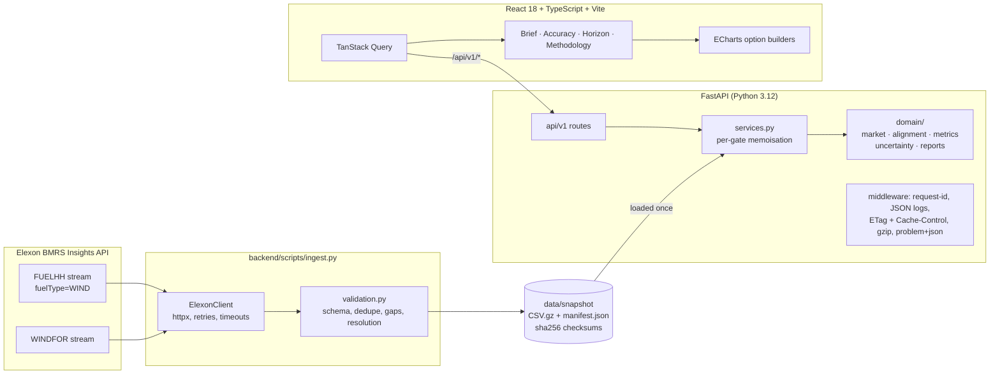

# WindDesk: day-ahead wind forecast intelligence

**Live app:** https://zs6c78z.vercel.app · **API docs:** https://zs6c78z.vercel.app/api/docs

WindDesk is a pilot decision-support portal for the day-ahead procurement team of a UK
electricity utility. For every procurement decision made in **January 2026** it shows:

1. **Which wind forecast was actually available at the market gate closure.**
2. **How accurate that forecast turned out to be**, with quantified error, so purchases can be
   sized with the error in mind.

Data is limited to national wind data from Elexon BMRS: actuals from `FUELHH` (`fuelType=WIND`)
and forecasts from `WINDFOR`.


| Forecast Accuracy | Horizon Explorer |
|---|---|
|  |  |

---

## The business problem

The desk must buy power for delivery day **D+1** at the day-ahead auction on day **D**, before
gate closure. Whatever wind does not supply has to be bought elsewhere, and the decision is
made on a forecast. The desk therefore needs to know:

* **what the latest forecast said at the moment it had to decide** (no hindsight), and
* **how much to trust it**: typical error, bias, worst-case misses, and how error varies by
  hour, lead time and forecast vintage.

> WindDesk is decision support, not an automated trading system. Wind forecast error is
> **not** procurement error: the data has no demand, contract, price or other supply information.

### What January 2026 showed (09:50 N2EX gate)

All figures are computed by the app and the notebook from the validated snapshot.

| | |
|---|---|
| MAE / RMSE | **2,013 MW** / 2,506 MW (WAPE 17.8%) |
| Mean bias | **+1,730 MW**: the forecast was above actual output in **84%** of hours and on 28 of 31 days |
| Energy | forecast exceeded actual by **1,287 GWh** over the month (15% of actual) |
| P90 / max absolute error | 4,144 MW / 6,833 MW |
| P10–P90 band | **76.7%** held-out coverage (nominal 80%) |
| Value of waiting | the D−1 22:30 run is about 9% more accurate than the 09:30 run, but it comes after the gate. Most of the error is bias, which waiting does not remove |
| Stale feed | 26 Jan 18:30 → 27 Jan 09:30: five consecutive runs repeated identical values. The forecast used for **28 Jan** (the worst day, MAE 5.4 GW) was 15 h old at the gate. WindDesk flags this case |

---

## Product tour

| Screen | Purpose |
|---|---|
| **Day-Ahead Brief** (`/brief`) | Pick a decision date and a gate-closure scenario. It shows the forecast available at that cutoff (publish time, lead time), the delivery-day energy, peak and minimum, the typical historical error at that lead time, an empirical P10–P90 band, the forecast revision history, data-coverage pills and a stale-feed warning. **Reveal actuals** adds the hindsight view: actual line, day metrics, error columns. Hourly table with CSV export. |
| **Forecast Accuracy** (`/accuracy`) | January headline metrics; daily MAE/bias (click a bar to open that day's brief); error histogram; forecast-vs-actual scatter; error by hour of day and by lead time; comparison of all D−1 runs (available vs after gate); worst five days; band coverage check; data coverage. |
| **Horizon Explorer** (`/horizon`) | Pick a date range and a minimum lead time H. Each target hour uses the latest forecast published at least H hours earlier. |
| **Methodology** (`/methodology`) | Sources, time-zone handling, forecast selection, alignment, metric definitions, gate-closure sources and limitations, written for a trader. |

All view state lives in the URL, so every view can be shared, e.g.
`/brief?date=2026-01-27&gate=09:50&reveal=1`.

---

## Architecture



* **Snapshot, not live calls.** January 2026 is fixed history. The deployed app reads a
  validated, checksummed snapshot, so it is fast, deterministic and independent of Elexon
  uptime. `scripts/ingest.py` regenerates it.
* **Pure domain layer.** Selection, alignment, metrics and bands are pure pandas functions with
  no I/O and no HTTP. Route handlers only parse input and delegate.
* **One deployment on Vercel.** Vercel serves the React build from its CDN and runs FastAPI as
  a Python function (`api/index.py`) with the snapshot bundled. API responses carry
  `s-maxage` so the edge caches them. The Docker image packages the same app as a single
  container.

More detail, including design decisions and trade-offs: [`docs/architecture.md`](docs/architecture.md).

---

## Forecast selection: methodology and assumptions

For decision date **D** (UK local) and gate closure **G** (UK local wall-clock time):

1. `cutoff = D at G` in `Europe/London`, converted to UTC. An ambiguous autumn time resolves to
   its first occurrence; a time inside the spring-forward gap is rejected with a 422.
2. Delivery window = **D+1, 00:00–24:00 UK local**, in UTC (23 or 25 h on clock-change days).
3. Keep WINDFOR rows with `publishTime ≤ cutoff`.
4. Keep targets inside the window **and strictly after their publication**. Each run repeats
   about a day of past hours, which are not forecasts.
5. For each target hour, take the **latest eligible `publishTime`**.
6. Align with actuals and compute `error_mw = forecast_mw − actual_mw` (**positive = over-forecast**).

**Verified data semantics** (official spec and live responses, checked 2026-10-23):

* FUELHH `generation` = average MW over the 30-min settlement period starting at `startTime`.
* WINDFOR targets are **hourly** (73 per run, about D−1 21:00 to D+2 21:00), published 8 times a day at
  02:30, 04:30, 07:30, 09:30, 11:30, 15:30, 18:30 and 22:30 UK (January). Elexon's endpoint
  description lists 03:30…23:30. The January timestamps are one hour earlier, which matches a
  schedule fixed in CET. One late run on 15 Jan was published at 12:25.
* **Alignment:** the hourly forecast at `H` is compared with the **mean of the two half-hourly
  actuals** at `H` and `H+30m`. If either is missing, the hour is excluded, never estimated.
  Sensitivity check: using the first half-hour only changes MAE by under 1%.

**Gate-closure presets are configurable scenarios**, each documented with its source:

| Preset | UK time | Source (checked 2026-10-23) |
|---|---|---|
| N2EX day-ahead (Nord Pool) | 09:50 | Nord Pool support: *About the Day-ahead GB auction* |
| EPEX GB 60-min auction | 09:20 | EPEX SPOT trading brochure; S&P Global Platts note (Dec 2020) |
| EPEX GB 30-min auction | 15:30 | EPEX SPOT trading brochure |
| Custom | any HH:MM | e.g. to model a delay between `publishTime` and when data reaches users |

`publishTime` is treated as the availability time, as the brief defines it.

### Metric definitions

Every statistic uses **matched hours only**: a selected forecast and a complete actual.

| Metric | Definition |
|---|---|
| MAE | mean \|error\| (MW) |
| RMSE | √mean(error²) (MW) |
| Bias | mean error (MW); positive = over-forecast |
| WAPE | Σ\|error\| / Σ actual × 100; `null` if Σ actual = 0. MAPE is deliberately not used (it explodes at low wind) |
| P50/P90/P95/P99, max | percentiles of \|error\| (NumPy linear interpolation) |
| Correlation | Pearson r; `null` when n < 3 or a series is constant |
| Energy (MWh) | Σ hourly MW × 1 h over matched hours, so forecast and actual cover identical periods |
| Coverage | matched / expected hours; missing forecasts and incomplete actuals are counted separately |
| P10–P90 band | 10th/90th percentile of errors in the same 6 h lead-time bucket from **all other** delivery days (leave-one-day-out); shown only with ≥ 48 observations from ≥ 10 days. Held-out coverage is reported. It is an empirical interval, not a guarantee |

---

## API

Base path `/api/v1`. Timestamps are ISO-8601 UTC (`Z`), power in MW, energy in MWh. Errors use
`application/problem+json` (RFC 9457). Historical responses carry an `ETag` and long
`Cache-Control`. OpenAPI: `/api/docs`, `/api/openapi.json`.

| Endpoint | Description |
|---|---|
| `GET /health` | liveness + snapshot version (not cached) |
| `GET /meta` | scope, gate presets with sources, publication slots, data coverage |
| `GET /decisions/{date}?gate=09:50` | forecast available at the gate for delivery day D+1, plus band, typical error, revisions, hindsight metrics and hourly rows |
| `GET /accuracy?from=2026-01-01&to=2026-01-31&gate=09:50` | metrics over decision dates, broken down by day, hour, lead time and vintage; histogram, scatter, worst days, band coverage |
| `GET /horizon?from=2026-01-02&to=2026-02-01&horizon_h=24` | actual vs the latest forecast published at least `horizon_h` before each target |

```bash
curl "https://zs6c78z.vercel.app/api/v1/decisions/2026-01-27?gate=09:50"
```

---

## Running locally

**Docker (one command, production-like: API and UI on http://localhost:8000):**

```bash
docker compose up --build
```

**Development (hot reload).** Requires Python 3.12 with [uv](https://docs.astral.sh/uv/) and Node 22+.

```bash
cd backend && uv sync && uv run uvicorn app.main:app --reload --port 8000
```

```bash
cd frontend && npm ci && npm run dev
```

Open http://localhost:5173 (Vite proxies `/api` to port 8000). Configuration is optional; see
[`.env.example`](.env.example).

### Regenerating the snapshot

```bash
cd backend && uv run python scripts/ingest.py
```

or, in Docker:

```bash
docker compose run --rm ingest
```

The script fetches only what January decisions need: FUELHH settlement dates 2026-01-02 to
2026-02-01, and WINDFOR runs published from 72 h before the first delivery period to the end of
31 Jan. Missing fields, unparseable timestamps or empty results fail the run. Row-level problems
(non-numeric values, duplicates, off-grid timestamps) are removed and counted. Gaps are recorded
and never filled. Output: `data/snapshot/*.csv.gz` (reproducible gzip) and `manifest.json`
(scope, sources, validation report, sha256 checksums). The app refuses to start on a checksum
mismatch.

---

## Testing and quality

```bash
cd backend && uv run pytest && uv run ruff check . && uv run ruff format --check .
```

```bash
cd frontend && npm test && npm run lint && npm run typecheck && npm run build
```

* **Backend, 129 pytest tests.**
  * Look-ahead guards: no selected forecast is published after the cutoff, checked for all 31
    January decisions across 36 gate times on the real snapshot.
  * Cutoff equality, exclusion of non-future targets, duplicate publications, per-hour fallback
    to older runs, half-open windows.
  * Hourly aggregation and partial hours; GMT/BST conversion, 23 h and 25 h days, ambiguous and
    nonexistent times.
  * Metrics against hand-computed values, WAPE zero denominator, undefined correlation,
    empty input; leave-one-day-out isolation and band coverage.
  * Validation and snapshot checksums; Elexon client retry and timeout behaviour.
  * API contracts, problem+json errors, ETag/304.
* **Frontend, 23 Vitest + Testing Library tests.** Formatting (UK time across BST), URL-param
  validation, CSV escaping and formula-injection guard, chart builders (actuals never drawn
  before *Reveal*), and page behaviour with a mocked API.
* **CI** (`.github/workflows/ci.yml`): backend lint + tests + lockfile/requirements sync;
  frontend lint, format, tests and build; Docker build + smoke test.

---

## Repository guide

```
.
├── api/index.py                 Vercel entrypoint: exposes backend FastAPI app
├── backend/
│   ├── app/
│   │   ├── main.py              App factory: middleware, error handlers, optional SPA serving
│   │   ├── config.py            Pydantic settings (WINDDESK_* env vars)
│   │   ├── observability.py     JSON logs, request IDs, Server-Timing, ETag caching
│   │   ├── services.py          Snapshot-backed analytics service (per-gate memoisation)
│   │   ├── api/                 deps.py (DI, gate parsing), errors.py (problem+json), v1/routes.py
│   │   ├── schemas/             Pydantic response models (the API contract)
│   │   ├── domain/              Pure logic: market.py, alignment.py, metrics.py,
│   │   │                        uncertainty.py, reports.py
│   │   └── data/                elexon_client.py, validation.py, snapshot.py
│   ├── scripts/ingest.py        Reproducible ingestion -> validated snapshot
│   ├── data/snapshot/           Committed January 2026 snapshot + manifest
│   ├── tests/                   pytest suite (unit, API, real-snapshot guards)
│   ├── pyproject.toml, uv.lock  Dependencies (uv), ruff, pytest config
├── frontend/
│   ├── src/api/                 Typed client, TanStack Query hooks, response types
│   ├── src/pages/               DayAheadBrief, ForecastAccuracy, HorizonExplorer, Methodology
│   ├── src/components/charts/   ECharts wrapper, theme (validated palette), option builders
│   ├── src/components/          layout, controls (gate/date pickers), ui primitives
│   ├── src/lib/                 formatting (UK time), URL params, CSV, insights
│   └── src/**/*.test.ts(x)      Vitest tests
├── analysis/forecast_error_analysis.ipynb   Executed analysis notebook (same domain code)
├── docs/architecture.md         Design, decisions, trade-offs
├── docs/VIDEO_SCRIPT.md         Script for the 10-minute demo video
├── docs/screenshots/            README images
├── Dockerfile, docker-compose.yml, .dockerignore, .env.example
├── vercel.json, .vercelignore, requirements.txt (exported from uv.lock)
└── .github/workflows/ci.yml
```

---

## Known limitations

* **Scope:** national wind only, from two datasets, one month. There is no demand, embedded
  generation, prices, imbalance or curtailment data, so WindDesk cannot size a purchase on its
  own.
* **Systematic over-forecast:** curtailment or constraint actions may explain part of the +1.7 GW
  bias (metered output reduced at high wind). The supplied data cannot confirm this.
* **Availability time:** `publishTime` is taken as the moment data became available. Any real
  publication lag can be modelled with an earlier custom gate.
* **WINDFOR value semantics** (hourly mean vs instantaneous) are not documented. The hourly-mean
  comparison is a stated assumption, and the sensitivity check shows it does not matter.
* **Band:** one month of autocorrelated errors. Coverage is reported, not guaranteed.
* **Delivery-day definition:** UK settlement day 00:00–24:00. Exchange products may use other
  delivery periods (e.g. 23:00–23:00).

## Next steps

A live ingestion schedule with stale-feed alerts; bias-corrected forecasts (the largest
accuracy gain available); demand and solar for net-position sizing; regional and BMU-level
detail; longer history for seasonal error models.

---

## Use of AI tools

This project was built with **Claude Code** (Anthropic), an AI coding assistant. It was used
to research the Elexon API and market rules, write code, tests and documentation, and run the
checks. All data handling choices, results and claims in this README were verified by running
the code and tests against the real snapshot.
