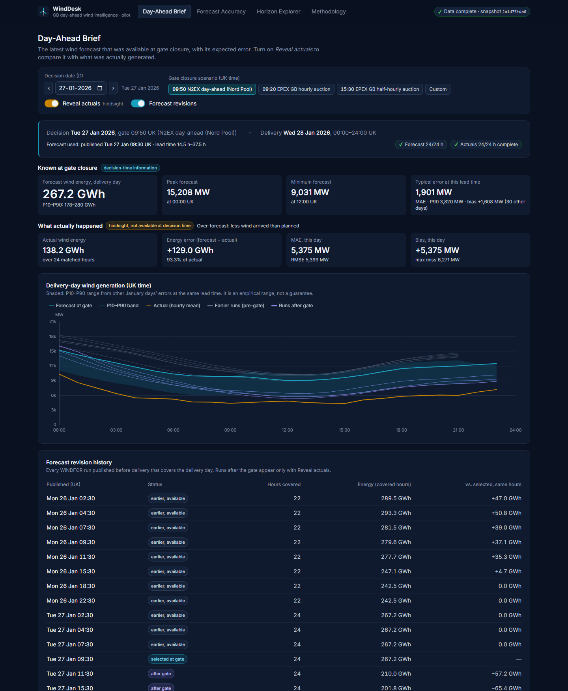
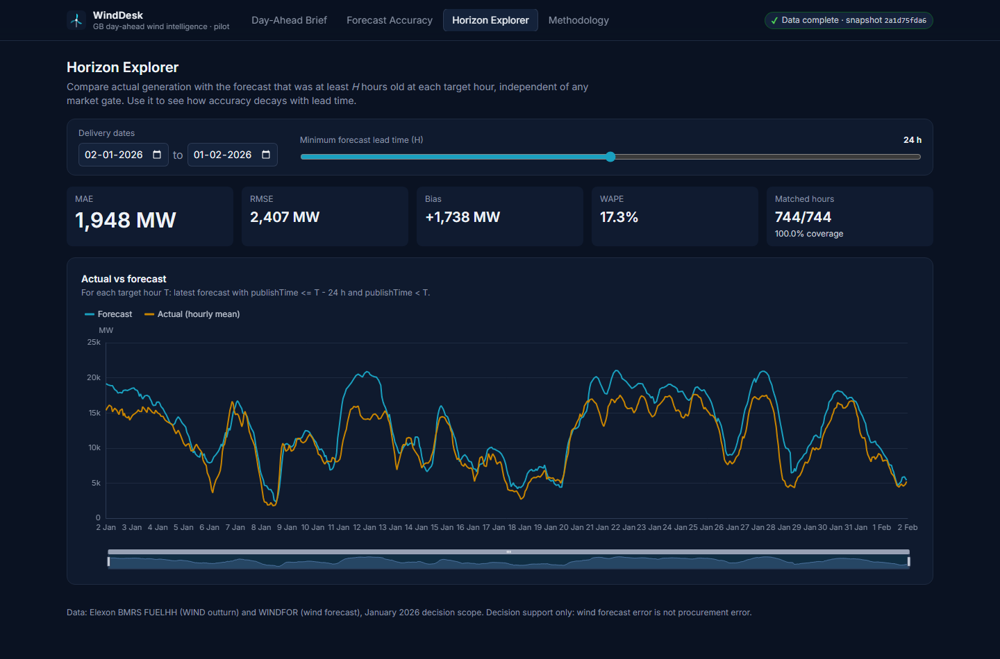
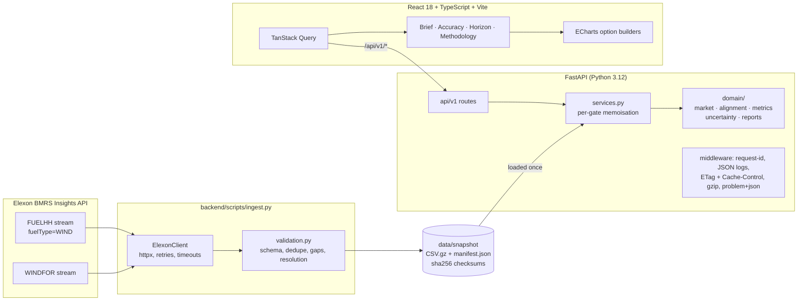

# WindDesk: day-ahead wind forecast intelligence

**Live app:** https://zs6c78z.vercel.app · **API docs:** https://zs6c78z.vercel.app/api/docs

WindDesk is a pilot decision-support portal for the day-ahead procurement team of a UK
electricity utility. For every procurement decision made in **January 2026** it shows:

1. **Which wind forecast was actually available at the market gate closure.**
2. **How accurate that forecast turned out to be**, with quantified error, so purchases can be
   sized with the error in mind.

Data is limited to national wind data from Elexon BMRS: actuals from `FUELHH` (`fuelType=WIND`)
and forecasts from `WINDFOR`.



| Forecast Accuracy | Horizon Explorer |
|---|---|
|  |  |

---

## The business problem

The desk must buy power for delivery day **D+1** at the day-ahead auction on day **D**, before
gate closure. Whatever wind does not supply has to be bought elsewhere, and the decision is
made on a forecast. The desk therefore needs to know:

* **what the latest forecast said at the moment it had to decide** (no hindsight), and
* **how much to trust it**: typical error, bias, worst-case misses, and how error varies by
  hour, lead time and forecast vintage.

> WindDesk is decision support, not an automated trading system. Wind forecast error is
> **not** procurement error: the data has no demand, contract, price or other supply information.

### What January 2026 showed (09:50 N2EX gate)

All figures are computed by the app and the notebook from the validated snapshot.

| | |
|---|---|
| MAE / RMSE | **2,013 MW** / 2,506 MW (WAPE 17.8%) |
| Mean bias | **+1,730 MW**: the forecast was above actual output in **84%** of hours and on 28 of 31 days |
| Energy | forecast exceeded actual by **1,287 GWh** over the month (15% of actual) |
| P90 / max absolute error | 4,144 MW / 6,833 MW |
| P10–P90 bands | hourly band: **76.7%** held-out coverage; daily energy range: **74%** of days (nominal 80% for both) |
| Value of waiting | the D−1 22:30 run is about 9% more accurate than the 09:30 run, but it comes after the gate. Most of the error is bias, which waiting does not remove |
| Stale feed | 26 Jan 18:30 → 27 Jan 09:30: five consecutive runs repeated identical values. The forecast used for **28 Jan** (the worst day, MAE 5.4 GW) was 15 h old at the gate. WindDesk flags this case |

---

## Product tour

| Screen | Purpose |
|---|---|
| **Day-Ahead Brief** (`/brief`) | Opens on the latest decision (31 Jan). Pick a decision date and a gate-closure scenario. A headline sentence states what the forecast available at that cutoff expected. Tiles show energy with a daily P10–P90 range, peak and minimum, and the **typical error known at the gate** (from January days already completed). The view also has an hourly P10–P90 band, the forecast revision history, coverage pills, and partial-day and stale-feed warnings. **Reveal actuals** adds the hindsight view: actual line, day metrics, error columns. Hourly table with CSV export (UK and UTC timestamps, same rows as the table). **Procurement what-if:** enter your demand (flat MW) and the share of national wind you can count on. WindDesk shows how much to buy beyond wind if it arrives as forecast and in a low-wind (P10) case, and, in hindsight, how short each plan would have been. These columns also appear in the table and the CSV. Every tile explains its metric. |
| **Forecast Accuracy** (`/accuracy`) | January headline metrics; an hourly **timeline of the forecast available at the gate vs actual** for the whole range (zoomable); daily MAE/bias (click a bar to open that day's brief); error histogram; forecast-vs-actual scatter; error by hour of day and by lead time; comparison of all D−1 runs (available vs after gate); worst five days; band coverage check; data coverage. |
| **Horizon Explorer** (`/horizon`) | Pick a date range and a minimum lead time H. Each target hour uses the latest forecast published at least H hours earlier. |
| **Methodology** (`/methodology`) | Sources, time-zone handling, forecast selection, alignment, metric definitions, gate-closure sources and limitations, written for a trader. |

All view state lives in the URL, so every view can be shared, e.g.
`/brief?date=2026-01-27&gate=09:50&reveal=1`.

---

## Architecture



* **Snapshot, not live calls.** January 2026 is fixed history. The deployed app reads a
  validated, checksummed snapshot, so it is fast, deterministic and independent of Elexon
  uptime. `scripts/ingest.py` regenerates it.
* **Pure domain layer.** Selection, alignment, metrics and bands are pure pandas functions with
  no I/O and no HTTP. Route handlers only parse input and delegate.
* **One deployment on Vercel.** Vercel serves the React build from its CDN and runs FastAPI as
  a Python function (`api/index.py`) with the snapshot bundled. API responses carry
  `s-maxage` so the edge caches them. The Docker image packages the same app as a single
  container.

More detail, including design decisions and trade-offs: [`docs/architecture.md`](docs/architecture.md).

---

## Forecast selection: methodology and assumptions

For decision date **D** (UK local) and gate closure **G** (UK local wall-clock time):

1. `cutoff = D at G` in `Europe/London`, converted to UTC. An ambiguous autumn time resolves to
   its first occurrence; a time inside the spring-forward gap is rejected with a 422.
2. Delivery window = **D+1, 00:00–24:00 UK local**, in UTC (23 or 25 h on clock-change days).
3. Keep WINDFOR rows with `publishTime ≤ cutoff`.
4. Keep targets inside the window **and strictly after their publication**. Each run repeats
   about a day of past hours, which are not forecasts.
5. For each target hour, take the **latest eligible `publishTime`**.
6. Align with actuals and compute `error_mw = forecast_mw − actual_mw` (**positive = over-forecast**).

**Verified data semantics** (official spec and live responses, checked 2026-10-23):

* FUELHH `generation` = average MW over the 30-min settlement period starting at `startTime`.
* WINDFOR targets are **hourly** (73 per run, about D−1 21:00 to D+2 21:00), published 8 times a day at
  02:30, 04:30, 07:30, 09:30, 11:30, 15:30, 18:30 and 22:30 UK (January). Elexon's endpoint
  description lists 03:30…23:30. The January timestamps are one hour earlier, which matches a
  schedule fixed in CET. One late run on 15 Jan was published at 12:25.
* **Alignment:** the hourly forecast at `H` is compared with the **mean of the two half-hourly
  actuals** at `H` and `H+30m`. If either is missing, the hour is excluded, never estimated.
  Sensitivity check: using the first half-hour only changes MAE by under 1%.

**Gate-closure presets are configurable scenarios**, each documented with its source:

| Preset | UK time | Source (checked 2026-10-23) |
|---|---|---|
| N2EX day-ahead (Nord Pool) | 09:50 | Nord Pool support: *About the Day-ahead GB auction* |
| EPEX GB 60-min auction | 09:20 | EPEX SPOT trading brochure; S&P Global Platts note (Dec 2020) |
| EPEX GB 30-min auction | 15:30 | EPEX SPOT trading brochure |
| Custom | any HH:MM | e.g. to model a delay between `publishTime` and when data reaches users |

`publishTime` is treated as the availability time, as the brief defines it.

### Metric definitions

Every statistic uses **matched hours only**: a selected forecast and a complete actual.

| Metric | Definition |
|---|---|
| MAE | mean \|error\| (MW) |
| RMSE | √mean(error²) (MW) |
| Bias | mean error (MW); positive = over-forecast |
| WAPE | Σ\|error\| / Σ actual × 100; `null` if Σ actual = 0. MAPE is deliberately not used (it explodes at low wind) |
| P50/P90/P95/P99, max | percentiles of \|error\| (NumPy linear interpolation) |
| Correlation | Pearson r; `null` when n < 3 or a series is constant |
| Energy (MWh) | Σ hourly MW × 1 h over matched hours, so forecast and actual cover identical periods |
| Coverage | matched / expected hours; missing forecasts and incomplete actuals are counted separately |
| Typical error, known at gate | MAE/P90/bias at the same gate and lead-time buckets over delivery days that **ended before the decision day began**: what the desk could actually have known |
| Hourly P10–P90 band | 10th/90th percentile of errors in the same 6 h lead-time bucket from **all other** delivery days (leave-one-day-out, pilot calibration, includes later days); shown only with ≥ 48 observations from ≥ 10 days |
| Daily energy P10–P90 | 10th/90th percentile of **daily** energy errors on other fully forecast days (≥ 10). Hourly quantiles do not add up to a daily quantile, so they are not summed. Hidden for partially forecast days |
| Band coverage | share of held-out hours (hourly band) or days (daily range) inside the band. Empirical intervals, not guarantees |

---

## API

Base path `/api/v1`. Timestamps are ISO-8601 UTC (`Z`), power in MW, energy in MWh. Errors use
`application/problem+json` (RFC 9457).

* **Caching:** historical responses carry an `ETag` built from the data snapshot **and** a
  fingerprint of the backend code (`/health` reports it as `build`). Browsers revalidate on
  every request (`max-age=0, must-revalidate`, a cheap 304 when nothing changed), so a deploy
  is picked up immediately; the CDN keeps a copy for a day.
* **OpenAPI:** `/api/docs`, `/api/openapi.json`.

| Endpoint | Description |
|---|---|
| `GET /health` | liveness + snapshot version (not cached) |
| `GET /meta` | scope, gate presets with sources, publication slots, data coverage |
| `GET /decisions/{date}?gate=09:50` | forecast available at the gate for delivery day D+1, plus band, typical error, revisions, hindsight metrics and hourly rows |
| `GET /accuracy?from=2026-01-01&to=2026-01-31&gate=09:50` | metrics over decision dates, broken down by day, hour, lead time and vintage; histogram, scatter, worst days, band coverage |
| `GET /horizon?from=2026-01-02&to=2026-02-01&horizon_h=24` | actual vs the latest forecast published at least `horizon_h` before each target |

```bash
curl "https://zs6c78z.vercel.app/api/v1/decisions/2026-01-27?gate=09:50"
```

---

## Running locally

**Docker (one command, production-like: API and UI on http://localhost:8000):**

```bash
docker compose up --build
```

**Development (hot reload).** Requires Python 3.12 with [uv](https://docs.astral.sh/uv/) and Node 22+.

```bash
cd backend && uv sync && uv run uvicorn app.main:app --reload --port 8000
```

```bash
cd frontend && npm ci && npm run dev
```

Open http://localhost:5173 (Vite proxies `/api` to port 8000). Configuration is optional; see
[`.env.example`](.env.example).

### Regenerating the snapshot

```bash
cd backend && uv run python scripts/ingest.py
```

or, in Docker:

```bash
docker compose run --rm ingest
```

The script fetches only what January decisions need: FUELHH settlement dates 2026-01-02 to
2026-02-01, and WINDFOR runs published from 72 h before the first delivery period to the end of
31 Jan.

* **Fails the run:** missing fields, unparseable timestamps or empty results.
* **Removed and counted:** row-level problems (non-numeric values, duplicates, off-grid
  timestamps).
* **Recorded, never filled:** gaps.
* **Incomplete results are refused:** missing actual half-hours, or delivery hours with no
  forecast run, stop the run unless you pass `--allow-incomplete`. Accepted gaps are listed in
  the manifest.
* **Atomic publish:** the new snapshot is written to a staging directory and re-loaded with
  checksum verification before it replaces the old one. A failed or interrupted run never
  leaves a half-written snapshot.

Output: `data/snapshot/*.csv.gz` (gzip with `mtime=0` and LF line endings, so the same data
gives byte-identical files on Windows, macOS and Linux) and `manifest.json` (scope, sources,
validation report, sha256 checksums). The app refuses to start on a checksum mismatch.
Re-ingesting from the live API reproduced the committed snapshot `jan2026-113afcef1a` exactly,
both on Windows and inside the Docker image.

Re-run the analysis notebook:

```bash
uv run --project backend --group analysis jupyter execute --inplace analysis/forecast_error_analysis.ipynb
```

---

## Testing and quality

```bash
cd backend && uv run pytest && uv run ruff check . && uv run ruff format --check .
```

```bash
cd frontend && npm test && npm run lint && npm run typecheck && npm run build
```

End-to-end, against FastAPI serving the production build (uses the installed Google Chrome;
needs `npm run build` and `uv sync` in `backend/` first):

```bash
cd frontend && npm run test:e2e
```

* **Backend, 150 pytest tests.**
  * Look-ahead guards: no selected forecast is published after the cutoff, checked for all 31
    January decisions across 36 gate times on the real snapshot.
  * Cutoff equality, exclusion of non-future targets, duplicate publications, per-hour fallback
    to older runs, half-open windows.
  * Hourly aggregation and partial hours; GMT/BST conversion, 23 h and 25 h days, ambiguous and
    nonexistent times.
  * Metrics against hand-computed values, WAPE zero denominator, undefined correlation,
    empty input; leave-one-day-out isolation and band coverage.
  * Validation and snapshot checksums; Elexon client retry and timeout behaviour.
  * Ingestion safety: incomplete data refused, existing snapshot untouched on failure,
    identical bytes for identical input on any platform.
  * Known-at-gate error excludes later days; daily energy band (LODO, clipping, full-coverage
    only); late-run availability.
  * Bounded, single-flight caches (eight concurrent requests compute once).
  * API contracts, problem+json errors (including generic 500s with a request ID), security
    headers, ETag/304.
* **Frontend, 48 Vitest + Testing Library tests.**
  * Formatting (UK time across BST), URL-param validation.
  * CSV contents match the API rows; escaping and formula-injection guard.
  * Chart builders: actuals never drawn before *Reveal*; non-colour encodings.
  * Debounced slider commit; findings wording for positive and negative bias; partial-day and
    known-at-gate tiles; accessible metric hints.
  * Procurement what-if, hand-computed: clipping at zero, wind share, partial days, hindsight
    shortfall; plan columns in the CSV; timeline gaps kept as gaps.
* **End-to-end, 19 Playwright tests** (desktop and mobile):
  * Deep links, gate presets, date stepping, reveal by keyboard.
  * Downloaded CSV contents, partial days, invalid params.
  * API error plus retry, worst-day navigation and back, reload of deep links.
  * Slider commit, 404, no horizontal overflow on phones.
  * Landing on the latest decision; typing a demand (kept across reloads); plan columns in the
    downloaded CSV; the Accuracy timeline's accessible name.
* **CI** (`.github/workflows/ci.yml`):
  * Backend lint, tests and lockfile/requirements sync.
  * Frontend lint, format, types, tests and build.
  * Playwright end-to-end tests.
  * Docker build plus a smoke test (including the CSP header).

### Security and operations

* **No secrets:** none are in the repository; local Vercel credentials (`.env*.local`,
  `.vercel/`) are git-ignored and excluded from deploys.
* **Error responses:** generic `problem+json` 500s that carry an `X-Request-ID`, never exception
  text. Client-supplied request IDs are validated.
* **Headers:** `nosniff`, `X-Frame-Options: DENY`, a referrer policy and a CSP, from both
  FastAPI and `vercel.json`.
* **CORS:** off by default (same-origin).
* **Public API:** read-only and validated. Caches are bounded, so arbitrary gates or ranges
  cannot exhaust memory.
* **Docker image:** runs as a non-root user with a healthcheck. Static file serving is
  traversal-safe.
* **Dependency audits:**
  * `pip-audit -r requirements.txt`: no known vulnerabilities.
  * `npm audit --omit=dev`: 0 vulnerabilities.
  * Remaining advisories are dev-only tooling (Vite 5's esbuild dev server, Vitest 2, Tailwind
    3's selector parser) and need major upgrades.

---

## Repository guide

```
.
├── api/index.py                 Vercel entrypoint: exposes backend FastAPI app
├── backend/
│   ├── app/
│   │   ├── main.py              App factory: middleware, error handlers, optional SPA serving
│   │   ├── config.py            Pydantic settings (WINDDESK_* env vars)
│   │   ├── observability.py     JSON logs, request IDs, Server-Timing, ETag caching
│   │   ├── services.py          Snapshot-backed analytics service (per-gate memoisation)
│   │   ├── api/                 deps.py (DI, gate parsing), errors.py (problem+json), v1/routes.py
│   │   ├── schemas/             Pydantic response models (the API contract)
│   │   ├── domain/              Pure logic: market.py, alignment.py, metrics.py,
│   │   │                        uncertainty.py, reports.py
│   │   └── data/                elexon_client.py, validation.py, snapshot.py
│   ├── scripts/ingest.py        Reproducible ingestion -> validated snapshot
│   ├── data/snapshot/           Committed January 2026 snapshot + manifest
│   ├── tests/                   pytest: unit, API, ingestion safety, real-snapshot guards
│   ├── pyproject.toml, uv.lock  Dependencies (uv), ruff, pytest config
├── frontend/
│   ├── src/api/                 Typed client, TanStack Query hooks, response types
│   ├── src/pages/               DayAheadBrief, ForecastAccuracy, HorizonExplorer, Methodology
│   ├── src/components/charts/   ECharts wrapper, theme (validated palette), option builders
│   ├── src/components/          layout, controls (gate/date pickers), ui primitives
│   ├── src/lib/                 formatting (UK time), URL params, CSV + exports, insights
│   ├── src/hooks/               URL state, debounced commit, document title
│   ├── src/**/*.test.ts(x)      Vitest tests
│   ├── e2e/                     Playwright end-to-end tests
│   └── playwright.config.ts     Runs e2e against FastAPI serving the built app
├── analysis/forecast_error_analysis.ipynb   Executed analysis notebook (same domain code)
├── docs/architecture.md         Design, decisions, trade-offs
├── docs/VIDEO_SCRIPT.md         Script for the 10-minute demo video
├── docs/AUDIT_REPORT.md         Engineering audit: issues found, fixes, verification
├── docs/screenshots/            README images
├── Dockerfile, docker-compose.yml, .dockerignore, .env.example
├── vercel.json, .vercelignore, requirements.txt (exported from uv.lock)
└── .github/workflows/ci.yml
```

---

## Known limitations

* **Scope:** national wind only, from two datasets, one month. There is no demand, embedded
  generation, prices, imbalance or curtailment data, so WindDesk cannot size a purchase on its
  own.
* **Systematic over-forecast:** curtailment or constraint actions may explain part of the +1.7 GW
  bias (metered output reduced at high wind). The supplied data cannot confirm this.
* **Availability time:** `publishTime` is taken as the moment data became available. Any real
  publication lag can be modelled with an earlier custom gate.
* **WINDFOR value semantics** (hourly mean vs instantaneous) are not documented. The hourly-mean
  comparison is a stated assumption, and the sensitivity check shows it does not matter.
* **Bands and pilot calibration:** one month of errors that are autocorrelated within and
  across days. Leave-one-day-out uses days after each decision (pilot calibration; labelled in
  the UI), and coverage is reported, not guaranteed. A live deployment would use trailing
  history only, which is what the *known at gate* error already does.
* **Delivery-day definition:** UK settlement day 00:00–24:00. Exchange products may use other
  delivery periods (e.g. 23:00–23:00).

## Next steps

A live ingestion schedule with stale-feed alerts; bias-corrected forecasts (the largest
accuracy gain available); demand and solar for net-position sizing; regional and BMU-level
detail; longer history for seasonal error models.

---

## Use of AI tools

This project was built with **Claude Code** (Anthropic), an AI coding assistant. It was used
to research the Elexon API and market rules, write code, tests and documentation, and run the
checks. All data handling choices, results and claims in this README were verified by running
the code and tests against the real snapshot.
