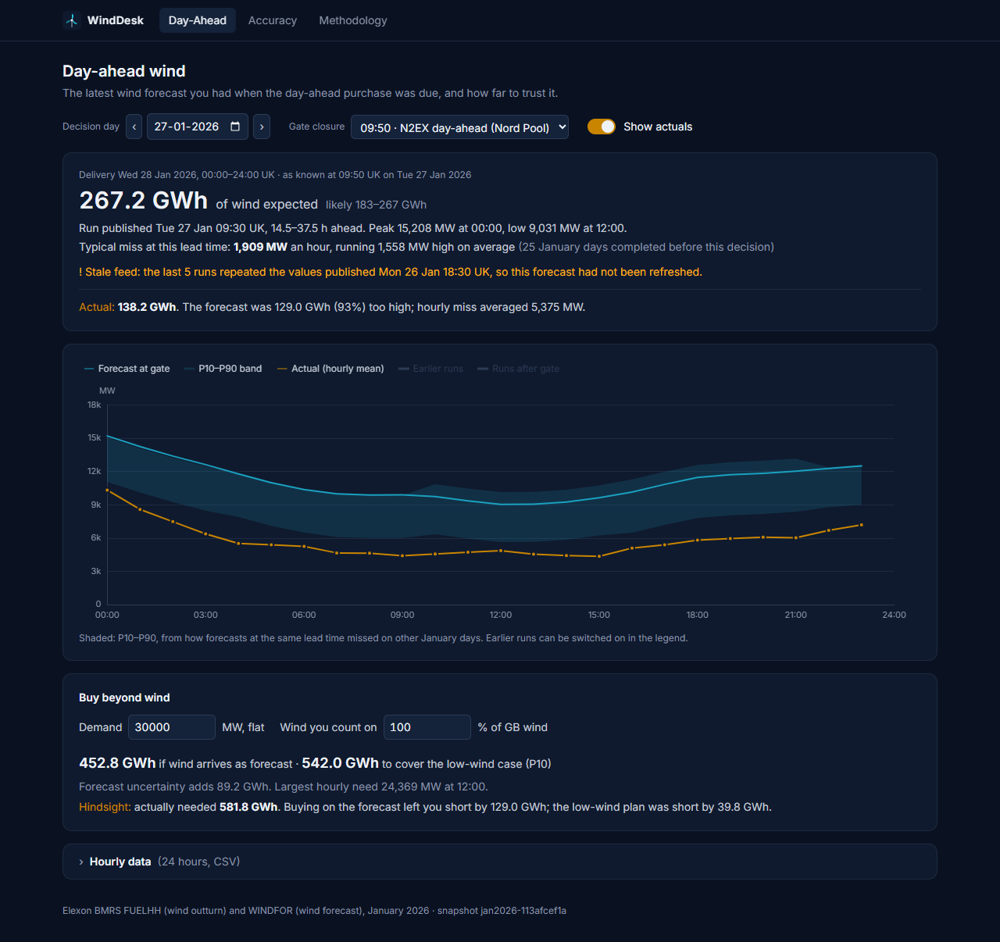
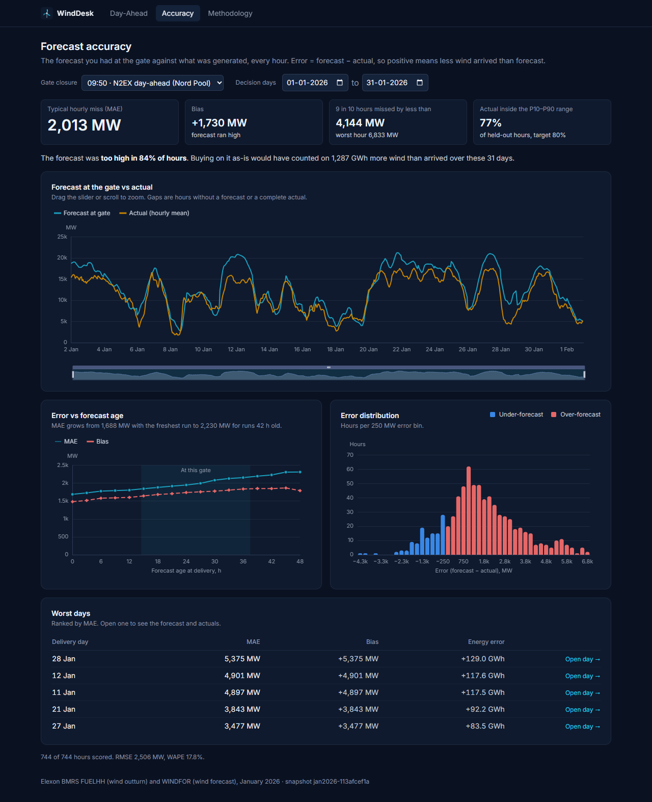

# WindDesk

A day-ahead wind forecast tool for the procurement desk of a GB electricity utility, covering
purchase decisions made in January 2026.

**App:** https://zs6c78z.vercel.app · **API docs:** https://zs6c78z.vercel.app/api/docs

The desk buys tomorrow's power in today's day-ahead auction, before gate closure, and whatever
wind does not supply has to be bought elsewhere. WindDesk answers the two questions behind that:

1. **What did the latest wind forecast say when the purchase was due?** (Day-Ahead page)
2. **How wrong does that forecast tend to be, and in which direction?** (Accuracy page)

Data: Elexon BMRS `FUELHH` (`fuelType=WIND`) for actual generation and `WINDFOR` for forecasts,
nothing else.





## What January 2026 showed (09:50 N2EX gate)

| | |
|---|---|
| Typical hourly miss | MAE **2,013 MW** (RMSE 2,506 MW, WAPE 17.8%); 9 in 10 hours under 4,144 MW, worst 6,833 MW |
| Direction | bias **+1,730 MW**: too high in 84% of hours and on 28 of 31 days, **1,287 GWh** (15%) more wind than arrived |
| Fresher runs | even the freshest run misses by 1,688 MW with a +1,481 MW bias, so most of the error is bias, not age |
| P10–P90 range | held the actual in 76.7% of held-out hours and 74% of days (target 80%) |
| Stale feed | from 26 Jan 18:30, five runs repeated identical values; 28 Jan, the worst day (MAE 5.4 GW), was planned on that forecast. The app flags it |

## How it works

**The forecast you had at the gate.** For decision day D and gate time G (UK local):

1. cutoff = D at G in `Europe/London`, converted to UTC (an ambiguous autumn time takes its first
   occurrence; a time in the spring-forward gap is rejected);
2. delivery day = D+1, 00:00–24:00 UK (23 or 25 hours on clock-change days);
3. keep WINDFOR rows with `publishTime ≤ cutoff` and a target inside the delivery day that is
   after its own `publishTime` (each run repeats about a day of past hours);
4. for each hour, take the latest eligible run.

Gate presets are documented scenarios with sources shown in the app: 09:50 N2EX day-ahead, 09:20
EPEX GB hourly auction, 15:30 EPEX GB half-hourly auction, or any custom time.

**Scoring.** WINDFOR is hourly and FUELHH half-hourly, so each hour is compared with the mean of
its two half-hours; hours missing either are left out, never filled in. Error = forecast − actual
(positive means less wind arrived than forecast).

**How far to trust it.** The typical miss on the Day-Ahead page uses only January days that had
finished before the decision. The hourly P10–P90 range comes from errors at the same lead time
(6 h buckets) on every other January day, leaving the day itself out; the daily GWh range uses
daily energy errors, because hourly percentiles do not add up. Both are a one-month pilot
calibration, and the Accuracy page reports how often they held.

**Buy beyond wind.** Enter a flat demand and the share of GB wind you can count on; the page shows
the volume to buy if wind arrives as forecast and in the low-wind (P10) case, and, with actuals
shown, how short each plan was.

## Design decisions

* **Committed snapshot, not live calls.** January 2026 is fixed history. `scripts/ingest.py`
  fetches only what the decisions need, validates it (gaps recorded, never imputed) and writes a
  checksummed `CSV.gz` snapshot atomically; the API refuses to start on a checksum mismatch.
  Re-ingesting reproduces the committed snapshot byte for byte.
* **Pure domain layer.** Selection, alignment, metrics and bands are pandas functions with no
  I/O (`backend/app/domain`), so tests drive them with small synthetic frames.
* **No hindsight by default.** Actuals and runs published after the gate appear only when you
  switch on *Show actuals*. Tests check, for every January decision at 36 gate times on the real
  data, that no selected forecast was published after the cutoff.
* **The URL is the state.** Every view is a shareable link, e.g.
  `/brief?date=2026-01-27&gate=09:50&reveal=1`.
* **One deployment.** Vercel serves the React build from its CDN and FastAPI as a Python function
  with the snapshot bundled. Responses carry an ETag from the snapshot and a fingerprint of the
  backend code, so a deploy is picked up at once. The Docker image runs the same app in one
  container.

## Run it

```bash
docker compose up --build
```

Then open http://localhost:8000. For development with hot reload (Python 3.12 with
[uv](https://docs.astral.sh/uv/), Node 22+):

```bash
cd backend && uv sync && uv run uvicorn app.main:app --reload --port 8000
```

```bash
cd frontend && npm ci && npm run dev
```

Open http://localhost:5173. To rebuild the data snapshot from Elexon:
`cd backend && uv run python scripts/ingest.py`.

**Tests.** Backend: 153 pytest tests (`uv run pytest`, `uv run ruff check .`). Frontend: 47
Vitest tests (`npm test`, `npm run lint`, `npm run typecheck`) and 18 Playwright end-to-end
tests against the production build in Chrome, desktop and phone (`npm run build && npm run
test:e2e`). CI runs all of them plus a Docker build and smoke test.

## Repository

```
api/index.py              Vercel entry point for the FastAPI app
backend/app/domain/       market time rules, forecast selection and alignment, metrics, bands
backend/app/services.py   per-gate cached analytics behind the API
backend/app/api/          routes /api/v1: meta, decisions/{date}, accuracy, horizon, health
backend/app/data/         Elexon client, validation, snapshot read/write
backend/scripts/ingest.py reproducible ingestion into backend/data/snapshot
backend/tests/            unit, API, ingestion and real-snapshot look-ahead tests
frontend/src/pages/       Day-Ahead, Accuracy, Methodology
frontend/src/components/  charts (ECharts option builders), controls, layout, UI primitives
frontend/src/lib/         UK-time formatting, URL params, CSV export, buy-beyond-wind maths
frontend/e2e/             Playwright tests
analysis/                 notebook reproducing the January figures with the same domain code
Dockerfile, docker-compose.yml, vercel.json, .github/workflows/ci.yml
```

## Limits

* National wind only, for one month. There is no demand, price, embedded wind or curtailment data,
  so wind forecast error is not procurement error; the buy-beyond-wind numbers are a what-if.
* `publishTime` is taken as the moment a forecast became available; a custom gate models any lag.
* Part of the +1.7 GW bias may be curtailment of metered wind farms, which this data cannot show.
* Next steps: live ingestion with stale-feed alerts, a bias-corrected forecast, demand and
  contracts for a net-position view, and longer history for seasonal error models.

## Use of AI tools

Built with **Claude Code** (Anthropic) as a coding assistant: researching the Elexon API and
market rules, writing code, tests and documentation, and running the checks. Every figure in
this README was checked by running the code against the real snapshot.
